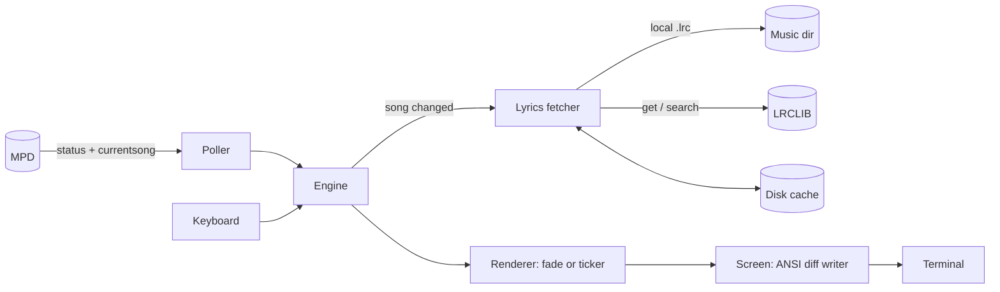

# mpd-lyrics

Synchronised lyrics for [MPD](https://www.musicpd.org/) in your terminal, fetched **dynamically** from
[LRCLIB](https://lrclib.net) for whatever is playing right now.

- **Single static binary**, written in Go, **zero third-party dependencies**.
- **Two display modes**
  - `ticker`: news-ticker style horizontal scrolling (default direction: from the right, configurable).
  - `fade`: several lines, text in **green**, current line highlighted in **yellow** (both configurable).
- **Everything is configurable** per platform: colours, font size of normal and current lines, direction, fade, and more.
- **Never static**: lookups go to LRCLIB when the song changes, results (and misses) are cached on disk.
- Linux, macOS, Windows, FreeBSD, OpenBSD, NetBSD.


<p align="center">
  <a href="https://raw.githubusercontent.com/licface15/images/refs/heads/main/mpd-lyric/fade.gif" target="_blank">
    
  </a>
</p>

<p align="center">
  <a href="https://raw.githubusercontent.com/licface15/images/refs/heads/main/mpd-lyric/ticker.gif" target="_blank">
    
  </a>
</p>



## Install

Download a binary from the [Releases](../../releases) page, or build from source (Go 1.22+):

```sh
git clone https://github.com/cumulus13/mpd-lyrics && cd mpd-lyrics
make build            # ./mpd-lyrics
make install          # into $(go env GOPATH)/bin
```

> The module path `github.com/cumulus13/mpd-lyrics` is a placeholder. Replace it in `go.mod`, the Go imports,
> the `-ldflags`/User-Agent string in `internal/app/engine.go` and the links in this repository before publishing
> (`grep -rl cumulus13 . | xargs sed -i 's#cumulus13#<your-github-user>#g'`).

## Quick start

```sh
mpd-lyrics -init          # write a fully commented config file
mpd-lyrics -doctor        # check config, MPD connection and a lyric lookup
mpd-lyrics                # fade mode (default)
mpd-lyrics -mode ticker   # news-ticker mode
```

MPD is found via `-host/-port`, the config file, `$MPD_HOST` / `$MPD_PORT` (including `password@host` and unix
sockets), then `localhost:6600`.

### Keys

| Key | Action |
| --- | --- |
| `m` / `Tab` | switch fade ↔ ticker |
| `+` `-` / `→` `←` | shift lyric timing by 100 ms (positive = earlier) |
| `0` | reset the runtime offset |
| `[` `]` | smaller / larger current-line font (kitty or DEC terminals) |
| `d` | flip ticker direction |
| `Space`, `n`, `p` | pause, next, previous track in MPD |
| `r` | re-fetch lyrics from LRCLIB (bypass cache) |
| `?` | show / hide key help |
| `q`, `Ctrl-C` | quit |

## Configuration in 30 seconds

```toml
[general]
mode = "ticker"

[style]
text_color    = "green"     # default
current_color = "yellow"    # default, the highlighted line
font_size = 1
current_font_size = 2       # needs scale_method kitty or dec

[ticker]
direction = "from_right"    # or "from_left"

# Any key can be overridden per operating system:
[platform.windows.style]
text_color = "#00c853"
```

Full reference: [docs/CONFIGURATION.md](docs/CONFIGURATION.md).

## Documentation

| Document | Contents |
| --- | --- |
| [docs/USAGE.md](docs/USAGE.md) | modes, keys, command-line flags, lyric sources |
| [docs/CONFIGURATION.md](docs/CONFIGURATION.md) | every option, platform overrides, precedence |
| [docs/ARCHITECTURE.md](docs/ARCHITECTURE.md) | components, data flow, ticker maths (Mermaid diagrams) |
| [docs/INTEGRATIONS.md](docs/INTEGRATIONS.md) | Waybar, Polybar, tmux, sway/i3, latency offset |
| [docs/TROUBLESHOOTING.md](docs/TROUBLESHOOTING.md) | common problems and `-doctor` |
| [CONTRIBUTING.md](CONTRIBUTING.md) | development workflow, tests, releases |
| [CHANGELOG.md](CHANGELOG.md) | release notes |

## Credits and etiquette

Lyrics come from the community-run, free [LRCLIB](https://lrclib.net) service. mpd-lyrics identifies itself with a
descriptive User-Agent, caches every answer (30 days, misses 24 hours by default) and only queries when the song
changes. Please keep it that way, and consider contributing missing lyrics to LRCLIB.

License: [MIT](LICENSE).

## 👤 Author
        
[Hadi Cahyadi](mailto:cumulus13@gmail.com)
    

[](https://www.buymeacoffee.com/cumulus13)

[](https://ko-fi.com/cumulus13)
 
[Support me on Patreon](https://www.patreon.com/cumulus13)