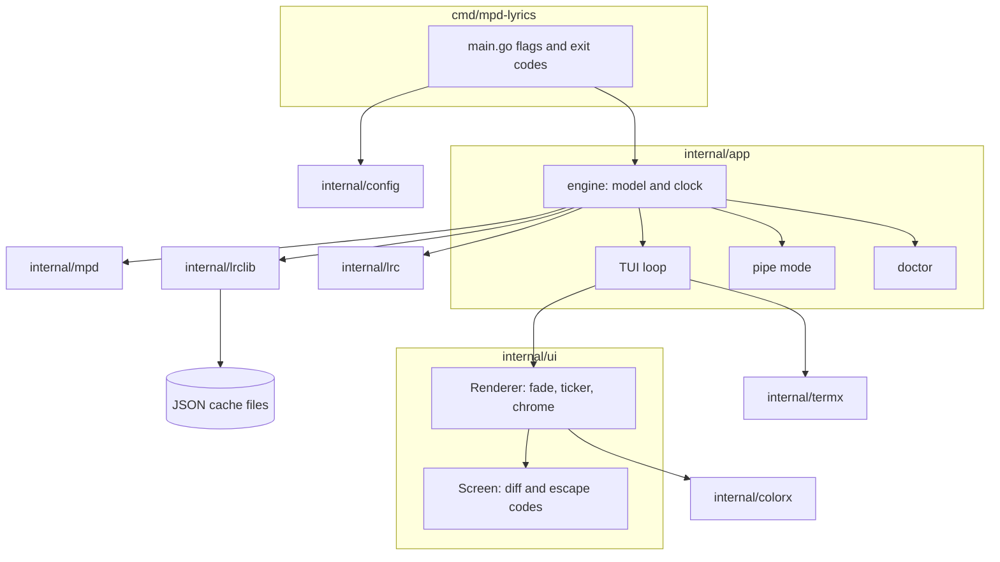
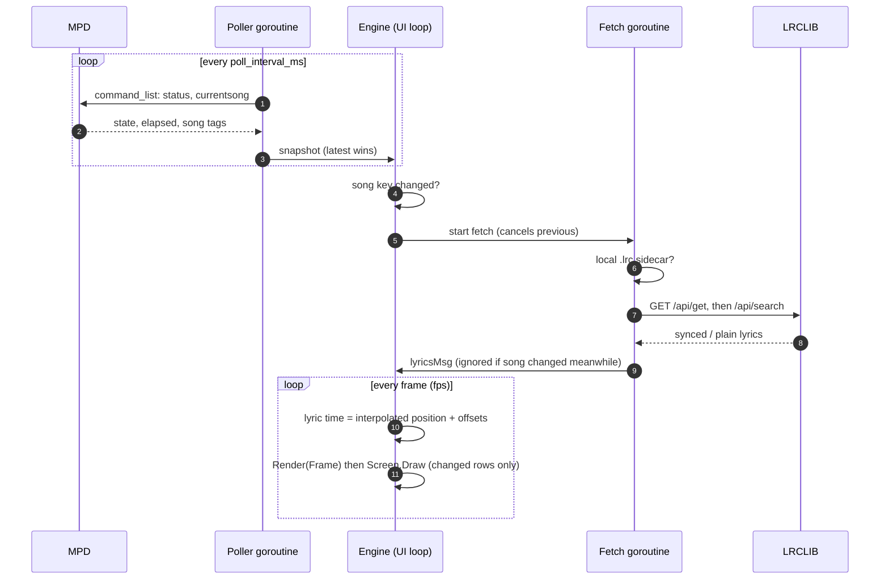
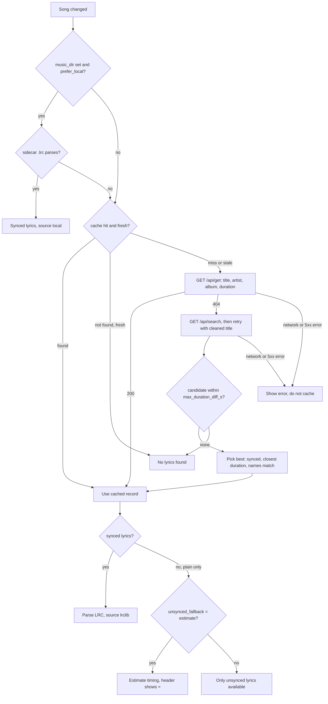
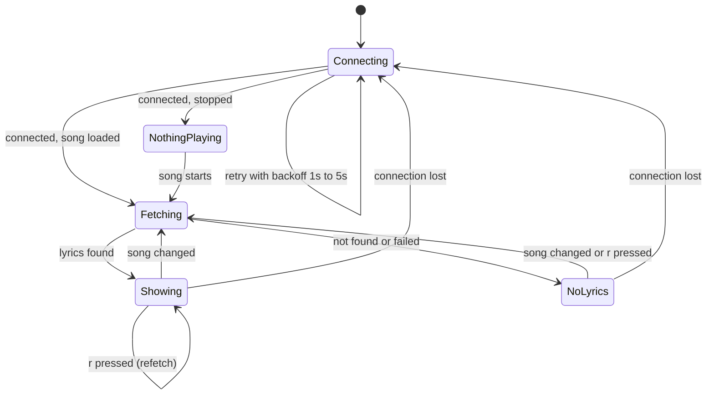
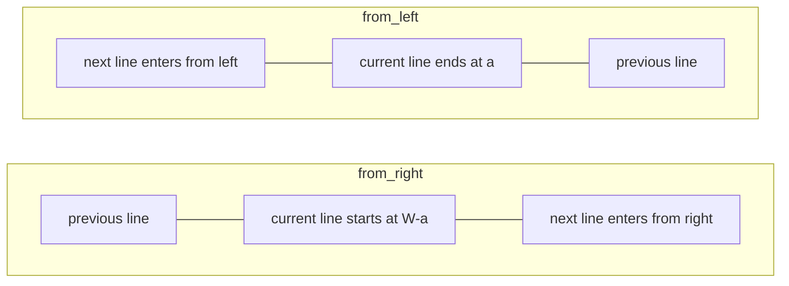

# Architecture

mpd-lyrics is a set of small packages under `internal/`, using only the Go standard library.

| Package | Responsibility |
| --- | --- |
| `mpd` | MPD text protocol: connect, password, `status` + `currentsong` in one round trip, pause/next/previous |
| `lrclib` | LRCLIB client: exact get, fuzzy search, candidate scoring, title clean-up, disk cache |
| `lrc` | LRC parser (multi-stamp, `[offset:]`, word tags), plain-text lyrics, timing estimation, line lookup |
| `config` | TOML-subset parser, platform overrides, validation, embedded default file |
| `colorx` | colour parsing, interpolation, truecolor/256/16 down-conversion, terminal detection |
| `termx` | terminal size, raw mode, VT enabling (Windows), key decoding, cell width of CJK/emoji |
| `ui` | pure layout (`Frame → []Row`) for both modes, and the diffing ANSI writer (`Screen`) |
| `app` | engine: poller, lyric fetching, clock, key handling, pipe mode, doctor |

## Components



## Runtime flow

The UI never blocks on the network. The poller and the lyric fetcher run in goroutines and hand results to the
single-threaded engine through channels; the engine owns all state.



### Playback clock

MPD is polled every 300 ms but frames are drawn at 30 fps, so the position is extrapolated
(`base + now − pollTime`) while playing. A new poll within 250 ms of the prediction nudges the clock by half the
error (no visible jumps); a larger error (seek) snaps to the new value. Pausing freezes it.

## Lyric resolution



## UI state machine



## Rendering

`ui.Renderer.Render(Frame) → []Row` is pure: same frame, same rows. That is what the unit tests assert (centring,
colours, cross-fade blends, ticker anchor and direction, wide-character clipping). `ui.Screen` encodes rows to
escape sequences, writes only rows that changed, and wraps each update in synchronized-output markers
(`CSI ? 2026 h/l`, ignored by terminals that do not support them) to avoid tearing.

### Ticker geometry

Let `W` be the width, `a = anchor·W`, line `i` start time `t_i`, and `adv_i` the tape distance of line `i`
(text width + separator width, scaled). The tape position `P(t)` is piecewise linear:

```
P(t_i) = Σ adv_j  for j < i
P(t) between t_i and t_{i+1} advances by exactly adv_i
```

The text of line `i` starts at screen column

```
from_right:  x_i(t) = (W − a) + P(t_i) − P(t)
from_left:   x_i(t) = a + (P(t) − P(t_i)) − textWidth_i      (text ends at the anchor)
```

so at `t = t_i`, `x_i = W − a`, i.e. the active line is always exactly at the anchor when its timestamp arrives, and
the speed on each segment is `adv_i / (t_{i+1} − t_i)`.



### Font size

`Row` carries `Scale` and `Part`. With `kitty`, a scaled run is emitted as `OSC 66 ; s=N ; text ST` on the first row
of its block (the terminal covers the following rows). With `dec`, rows are prefixed with `ESC # 3` (top half) and
`ESC # 4` (bottom half) so each glyph is double width and double height. Layout always reserves `Scale` rows per
scaled line, so the fade list stays centred.

## Design decisions

- **Own TOML subset instead of a library**: the build has no dependencies, and the subset covers all options.
- **Own MPD client**: only `status`, `currentsong`, `pause`, `next`, `previous` and `password` are needed.
- **Position interpolation**: smooth animation at any fps without hammering MPD.
- **Negative cache with a short TTL**: polite to LRCLIB, still picks up new uploads within a day.
- **No colour fallback logic in layouts**: layout produces RGB, `colorx.Profile` down-converts at the edge.

## 👤 Author
        
[Hadi Cahyadi](mailto:cumulus13@gmail.com)
    

[](https://www.buymeacoffee.com/cumulus13)

[](https://ko-fi.com/cumulus13)
 
[Support me on Patreon](https://www.patreon.com/cumulus13)