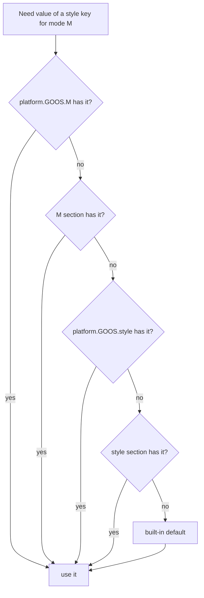

# Configuration reference

Generate a fully commented file with `mpd-lyrics -init`. Validate with `mpd-lyrics -check`. The file is a small
TOML subset: `[sections]`, `key = "string" | 'literal' | integer | float | true | false`, and `#` comments.
Arrays and inline tables are not used. Unknown keys produce a warning (typos are caught); invalid values are errors
that name the offending key.

## Precedence



`M` is `fade` or `ticker`; `GOOS` is `linux`, `darwin`, `windows`, `freebsd`, `openbsd`, `netbsd`. Non-style keys
(for example `general.fps`) check `[platform.GOOS.section]` first, then `[section]`.
Command-line flags (`-mode`, `-offset`, `-host`, `-port`) override the file.

```toml
[style]
text_color = "green"

[fade]
current_font_size = 2         # only fade mode

[platform.windows.style]
text_color = "#00c853"        # only on Windows

[platform.darwin.general]
color_mode = "256"            # only on macOS (Terminal.app has no truecolor)
```

## Colours

A name (`black red green yellow blue magenta cyan white gray orange pink purple lime`), `#rrggbb`, `#rgb` or
`rgb(r,g,b)`. Output adapts to the terminal: truecolor, 256 or 16 colours, or bold/dim only when colour is off
(`NO_COLOR` is honoured). Fading is real colour interpolation towards `fade_to`, so set `fade_to` to your
terminal background (`#ffffff` on light themes).

## `[general]`

| Key | Default | Description |
| --- | --- | --- |
| `mode` | `"fade"` | `fade` or `ticker` (`text` is an alias for `ticker`) |
| `fps` | `30` | redraw rate, 1–120 |
| `poll_interval_ms` | `300` | MPD polling interval, 50–5000. Position is interpolated between polls |
| `offset_ms` | `0` | shift lyrics; positive = earlier. Useful for Bluetooth/network latency |
| `color_mode` | `"auto"` | `auto`, `truecolor`, `256`, `16`, `none` |
| `scale_method` | `"auto"` | `auto`, `kitty`, `dec`, `none` (see [USAGE](USAGE.md#font-size-in-a-terminal)) |

## `[mpd]`

| Key | Default | Description |
| --- | --- | --- |
| `host` | `""` | empty → `$MPD_HOST` → `localhost`. `/path` or `@abstract` = unix socket |
| `port` | `0` | `0` → `$MPD_PORT` → `6600` |
| `password` | `""` | empty → password from `$MPD_HOST=password@host` |
| `timeout_ms` | `3000` | connect and command timeout |
| `music_dir` | `""` | library root; enables `.lrc` sidecar lookup |

## `[lrclib]`

| Key | Default | Description |
| --- | --- | --- |
| `base_url` | `"https://lrclib.net"` | point at a self-hosted LRCLIB if you run one |
| `timeout_ms` | `8000` | request timeout |
| `cache` | `true` | on-disk cache |
| `cache_dir` | `""` | empty → `<user cache dir>/mpd-lyrics` |
| `cache_ttl_days` | `30` | lifetime of found lyrics |
| `not_found_ttl_hours` | `24` | lifetime of "not found" |
| `max_duration_diff_s` | `8` | reject search hits whose length differs more than this; `0` disables |
| `unsynced_fallback` | `"estimate"` | `estimate` or `off` |
| `prefer_local` | `true` | try the `.lrc` sidecar before LRCLIB |

## `[style]` (and the same keys in `[fade]` / `[ticker]`)

| Key | Default | Description |
| --- | --- | --- |
| `text_color` | `"green"` | normal lyric text |
| `current_color` | `"yellow"` | current line (highlight). `highlight_color` is an accepted alias |
| `fade_to` | `"#000000"` | colour that non-current text fades towards |
| `font_size` | `1` | scale 1–7 of normal lines (fade mode) |
| `current_font_size` | `1` | scale 1–7 of the current line; in ticker mode of the whole tape |
| `bold_current` | `true` | bold current line |
| `wipe` | `false` | karaoke wipe on the current line |

Scales above what the terminal supports are clamped (see `scale_method`).

## `[fade]`

| Key | Default | Description |
| --- | --- | --- |
| `lines` | `9` | max visible lyric lines, 1–41 (odd looks best) |
| `spacing` | `1` | blank rows between lines, 0–3 |
| `fade_ms` | `400` | cross-fade duration on line change, 0–5000. Also used by ticker mode |
| `min_alpha` | `0.15` | opacity of the furthest line, 0–1 |
| `align` | `"center"` | `center` or `left` |

## `[ticker]`

| Key | Default | Description |
| --- | --- | --- |
| `direction` | `"from_right"` | `from_right` (text moves ←) or `from_left` (text moves →). Aliases: `right`/`rtl`, `left`/`ltr` |
| `anchor` | `0.3` | where a line starts when it becomes active, as a fraction of the width from the entry edge, 0–0.9 |
| `separator` | `"   ♪   "` | between lines on the tape |
| `edge_fade` | `8` | cells over which text fades at the screen edges, 0 = off |
| `neighbor_alpha` | `0.45` | opacity of non-current lines, 0–1 |

## `[ui]`

| Key | Default | Description |
| --- | --- | --- |
| `show_title` | `true` | header row: artist — title, play state, source, offset |
| `show_footer` | `true` | footer row for toasts and help |
| `show_help` | `false` | show key help (toggle with `?`) |


## 👤 Author
        
[Hadi Cahyadi](mailto:cumulus13@gmail.com)
    

[](https://www.buymeacoffee.com/cumulus13)

[](https://ko-fi.com/cumulus13)
 
[Support me on Patreon](https://www.patreon.com/cumulus13)