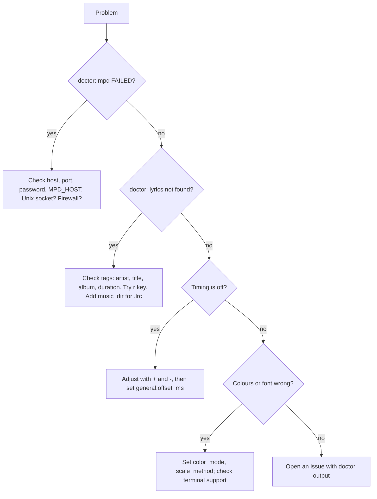

# Troubleshooting

Start with:

```sh
mpd-lyrics -doctor
```

It prints the config file in use (and warnings for unknown keys), the detected colour profile and font-scaling
method, MPD connectivity, the current song and the result of a lyric lookup.



| Symptom | Cause and fix |
| --- | --- |
| `Connecting to MPD…` forever | Wrong address. Set `[mpd] host/port`, `-host/-port`, or `$MPD_HOST`. Unix sockets: `host = "/run/mpd/socket"` |
| `incorrect password` | `password` in config, or `$MPD_HOST=password@host` |
| `No lyrics found` | LRCLIB has no entry, or tags differ. Lookups use title, artist, album and duration; fix tags or add a `.lrc` next to the file with `music_dir` set. Misses are cached 24 h; press `r` to retry now |
| `Lyrics lookup failed (...)` | Network problem or LRCLIB outage. Not cached; retried on next song or `r` |
| `≈ estimated` in header | Only unsynced lyrics exist; timing is a heuristic. Set `unsynced_fallback = "off"` to hide |
| Lyrics early or late | Latency or a different release. `+`/`-` live, then `offset_ms`. Lyrics from another edition: check `max_duration_diff_s` |
| Wrong lyrics for a remix or live version | Lower `max_duration_diff_s` (for example 3) |
| Grey/odd colours | Terminal lacks truecolor. Set `color_mode = "256"` or `"16"` |
| No fade look on a light theme | Set `fade_to = "#ffffff"` |
| `font_size` has no effect | Needs `scale_method = "kitty"` (kitty ≥ 0.40) or `"dec"` (xterm). Elsewhere it is ignored; change the font in terminal settings. Unsupported terminals may show garbage when forced |
| Garbled box drawing or `♪` | Terminal font or locale is not UTF-8 |
| CJK lyrics misaligned | Terminal must render East Asian wide characters as 2 cells; emoji width varies by terminal |
| Windows: escape codes printed | Use Windows Terminal or a recent conhost; VT processing is enabled automatically |
| `unknown config key` warning | Typo. Compare with `mpd-lyrics -print-config` |
| Config ignored | `-doctor` shows the path in use; `-config` and `$MPD_LYRICS_CONFIG` take priority |

## Cache

Files live in `<user cache dir>/mpd-lyrics` (`~/.cache/mpd-lyrics` on Linux, `~/Library/Caches/mpd-lyrics` on macOS,
`%LocalAppData%\mpd-lyrics` on Windows), one JSON file per track. Delete the directory to reset it, or run with
`-no-cache`.

## 👤 Author
        
[Hadi Cahyadi](mailto:cumulus13@gmail.com)
    

[](https://www.buymeacoffee.com/cumulus13)

[](https://ko-fi.com/cumulus13)
 
[Support me on Patreon](https://www.patreon.com/cumulus13)